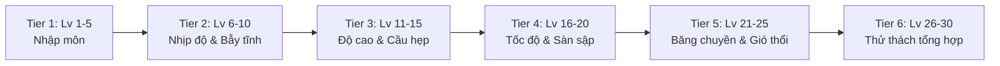

# Kế Hoạch Tăng Tiến Độ Khó & Bổ Sung Cơ Chế Gameplay (Ball Platform 3D)

## 1. Mục Tiêu (Goal)
Thiết kế đường cong độ khó (Difficulty Curve) tăng tiến tự nhiên từ Level 1 đến Level 30+ và bổ sung 4 cơ chế gameplay mới, giúp game hấp dẫn, giàu tính thử thách và kích thích giữ chân người chơi (player retention) mà không làm vỡ kiến trúc gốc.

---

## 2. Đường Cong Độ Khó Tăng Tiến (Difficulty Progression Curve)

| Giai đoạn | Dải Level | Tốc độ / Chiều dài | Cơ chế chính | Trải nghiệm cốt lõi |
| :--- | :--- | :--- | :--- | :--- |
| **Tier 1** | Level 1 - 5 | Ngắn (40-60m), đường rộng | Đường thẳng, cua nhẹ, ăn coin | Làm quen lực lăn, quán tính của bóng |
| **Tier 2** | Level 6 - 10 | Trung bình (60-80m) | Hurdle tĩnh, platform di động chậm | Căn khoảng cách và né chướng ngại vật |
| **Tier 3** | Level 11 - 15 | Trung bình dài (80-100m) | **Jump Pad (Bệ nảy)**, Cầu hẹp, bậc thang | Điều hướng trên không, giữ thăng bằng |
| **Tier 4** | Level 16 - 20 | Dài (100-120m) | **Speed Boost (Tăng tốc)** + **Sàn sập (Crumbling)** | Phản xạ tốc độ cao, không thể đứng yên |
| **Tier 5** | Level 21 - 25 | Dài (120-140m) | **Bẫy gai nhịp điệu (Spikes)** + Bệ trượt nhanh | Căn nhịp thời gian (Timing & Precision) |
| **Tier 6** | Level 26 - 30 | Rất dài (>140m) | Kết hợp toàn bộ cơ chế, ít checkpoint | Đỉnh cao thử thách, cảm giác chiến thắng lớn |

---

## 3. Danh Sách 4 Cơ Chế Mới Cần Bổ Sung

### A. Jump Pad (Bệ Nảy Cao)
* **Ý tưởng**: Khi bóng lăn lên bệ màu vàng/lò xo, kích hoạt lực nảy tức thì (`ForceMode.Impulse`) đẩy bóng phóng lên cao để vượt chướng ngại vật hoặc nhảy lên tầng trên.
* **Component**: `JumpPad.cs` + Audio SFX tiếng nảy lò xo + Animation nhún.

### B. Speed Boost Pad (Bệ Tăng Tốc Tức Thì)
* **Ý tưởng**: Lăn qua dải mũi tên phát sáng $\rightarrow$ bóng nhận gia tốc cực đại trong 1.5 giây để vượt qua khoảng vực dài.
* **Component**: `SpeedBoostPad.cs` + Particle vệt sáng gió.

### C. Crumbling Platform (Sàn Sập Sau Va Chạm)
* **Ý tưởng**: Khi bóng chạm mặt bệ, bệ bắt đầu rung lắc trong 0.7s, sau đó rơi tự do hoặc biến mất trong 2s rồi hồi lại.
* **Mục đích**: Chặn người chơi đứng dừng lại suy nghĩ, tạo cảm giác gấp gáp, hồi hộp.
* **Component**: `CrumblingPlatform.cs`.

### D. Periodic Trap (Bẫy Gai / Búa Đập Chu Kỳ)
* **Ý tưởng**: Gai nhọn hoặc búa xoay kích hoạt theo chu kỳ thời gian (ví dụ nhô lên 1s, thụt xuống 1.5s).
* **Mục đích**: Kiểm tra khả năng quan sát nhịp điệu và kiên nhẫn căn thời điểm lăn bóng.
* **Component**: `PeriodicTrap.cs`.

---

## 4. Kế Hoạch Triển Khai Cụ Thể (Actionable Tasks)

- [x] Task 1: Viết script `JumpPad.cs` và tạo Prefab `JumpPad.prefab` qua Unity CLI.
- [x] Task 2: Viết script `SpeedBoostPad.cs` và tạo Prefab `SpeedBoostPad.prefab` qua Unity CLI.
- [x] Task 3: Viết script `CrumblingPlatform.cs` và tạo Prefab `CrumblingPlatform.prefab` qua Unity CLI.
- [x] Task 4: Viết script `PeriodicTrap.cs` và tạo Prefab `PeriodicTrap.prefab` qua Unity CLI.
- [x] Task 5: Cập nhật công cụ `LevelGenerator.cs` để hỗ trợ tham số `DifficultyTier` (tự động phân bổ các chunk bệ nảy, bệ sập, bẫy chu kỳ theo cấp độ level) và chạy batch tạo thành công Level 16 đến 30.

## Done When
- [x] 4 cơ chế mới hoạt động độc lập, không bug vật lý, prefab nằm tại `Assets/Prefabs/Mechanics/`.
- [x] Level Generator tự động áp dụng cơ chế mới theo đúng dải độ khó của từng màn.
- [x] Đã sinh tự động và kích hoạt toàn bộ 15 level tiếp theo (`Level 16` -> `Level 30`) trong Build Settings theo đúng thứ tự chuyển màn.

